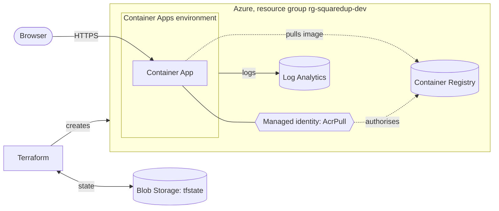

# Squared Up

A small kanban board deployed to Azure with Terraform, built as a hands-on way to learn Azure and infrastructure as code.

The infrastructure is built step by step in small modules. The app starts simple: three columns, cards you can move between them. Recurring and scheduled cards come after that.

> **Status:** the Azure platform (including PostgreSQL) is built and running a placeholder container. The kanban app works locally and is not deployed yet.

## Run the app locally

You need Node.js and Docker. From the repo root:

```bash
docker compose up -d                  # Postgres on localhost:5433
cd app
cp .env.example .env
npm install
./node_modules/.bin/prisma migrate dev
./node_modules/.bin/prisma generate
npm run dev                           # http://localhost:3000
```

(If your checkout path contains a `:` character, npm cannot find `node_modules/.bin` programs by name. Call them by path as above, or check the code out somewhere without one.)

## Architecture (so far)



The app pulls its image from a private registry using a managed identity, so there are no registry passwords. Terraform keeps its state in Azure Blob Storage, in a separate resource group so tearing the app down never deletes it.

## What exists today

| Piece | Azure service |
|---|---|
| Resource group, tags | Resource Manager |
| Spending alerts at 50, 75, 90 and 100% of a monthly budget | Cost Management budget |
| Logs | Log Analytics workspace (module `monitoring`) |
| Image storage and pull identity | Container Registry, user-assigned managed identity, `AcrPull` role (module `registry`) |
| Hosting | Container Apps environment and app, scale to zero (module `app`) |

## Roadmap

| Stage | What |
|---|---|
| Done | Foundations: remote state, resource group, budget, monitoring, registry, Container Apps |
| Next | PostgreSQL Flexible Server, then the kanban app (Next.js, Prisma), then deploy |
| Then | Recurring cards: a daily Container App Job spawns upcoming cards and moves them to To do when the date passes |
| Later | Sign-in (Entra ID), Key Vault, App Insights, private networking, CI/CD with GitHub Actions |

## Repo layout

```
app/                  Next.js app (scaffold so far)
infra/                Terraform root module
  modules/
    monitoring/       Log Analytics workspace
    registry/         Container Registry, pull identity, role assignment
    app/              Container Apps environment and app
docs/                 Design spec
```

## Running it yourself

You need an Azure subscription, the Azure CLI, Terraform and Docker.

1. Create the Terraform state storage once, by hand (a resource group, a storage account and a private `tfstate` container), and update the `backend` block in `infra/providers.tf` with your names.
2. Register the resource providers (`Microsoft.App`, `Microsoft.ContainerRegistry`, `Microsoft.OperationalInsights`, `Microsoft.ManagedIdentity` and so on).
3. From `infra/`:

```bash
az login
export ARM_SUBSCRIPTION_ID=$(az account show --query id -o tsv)
export TF_VAR_alert_email="you@example.com"
terraform init
terraform plan -out main.tfplan
terraform apply main.tfplan
```

4. Push an image to the new registry and the app will serve it at the `app_url` output.

Tear it down with `terraform destroy`. The state storage lives outside the config, so it survives.

## Cost

A small Basic registry costs a few pence a day, the workspace has a daily ingestion cap, and the app scales to zero. Planned PostgreSQL is the main running cost, so the stack is meant to be destroyed between sessions.

## How it's built

This is a learning project. I write the Terraform and app code, using Claude as a tutor and reviewer, and for some starter snippets. Each lesson is one commit.

## License

MIT
